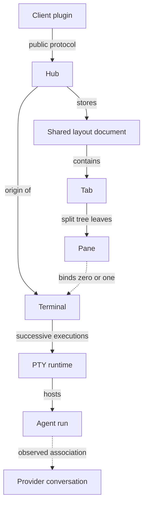

# Yolo concept model

Yolo separates runtime resources, presentation resources and extension declarations.
Each resource has its own identity and lifecycle. A view binding or observation
does not transfer ownership of the underlying process or provider history.

| Object | Identity | Lifetime | Owns | Does not mean |
| --- | --- | --- | --- | --- |
| Hub | `HubId` | durable Hub identity, across process restarts | origin, catalog and routing | a client window or one connection |
| Terminal | `TerminalAddress` | durable shell record | name, cwd, retained output and recovery | a provider conversation |
| Terminal runtime | `RuntimeTarget` (`TerminalAddress` + `runtime_epoch`) | one PTY/process tree | liveness, output cursor and writer lease | the terminal record |
| Observed agent execution | `AgentTarget` (`AgentAddress` + `execution_id`) | one observed Codex/Claude execution | provider activity, controls and observed status | a durable run record or a shell |
| Agent run | `AgentRunAddress` | durable Hub-owned run record | name, aliases, parent, workspace, terminal and lifecycle state | one observed execution; a replacement execution keeps the same run |
| Provider conversation | `ConversationAddress` | provider history, across agent executions | transcript and provider resume identity | a live PTY |
| Workspace | `WorkspaceAddress` | durable Hub record | name, root, kind, parent, terminal/run membership | a client layout or a directory that Yolo creates |
| Shared layout | `LayoutAddress` | Hub-stored document | tab collection and topology revision | a client window or input authority |
| Tab | `SharedTab` or client `TabEntry` ID | until removed from the layout | a named tab containing one pane tree | a terminal process |
| Pane | `Pane` ID | until removed from its tab; survives geometry revisions | optional terminal binding in the split tree | a tab or a writer lease |
| Client view | client-local identity | one attached TUI or trusted-plugin view | focus, selection, view mode and lease presentation | Hub custody |

## Tab and pane

A Tab is the named tab users switch between. A Pane is a leaf in that
Tab's split tree. A Tab may contain one or many Panes; a Pane binds at most
one `TerminalAddress`. `PaneLayoutDocument` is the local tree plus focus, while
`SharedLayoutDocument` is the Hub document containing shared tab trees. Focus,
scroll position and writer authority remain client-local.

The same words are used at three deliberately different boundaries:

* `SharedTab` is the Hub-owned tab resource. Its `root` is a tree of
  `Pane` values, and its identity is shared by every client attached to that
  layout document.
* `TabCatalog` is a TUI client's local catalog of those shared tabs. It
  stores the selected tab and a private `PaneLayoutDocument` projection; it
  does not create a second Hub tab resource.
* The TUI's `WorkspaceState` is the rendered projection of one selected shared
  tab. Its `WorkspaceNode` contains only `PaneState` leaves, so a pane ID is
  never a tab ID. The selected Hub tab ID stays in the TUI presentation state.

Code in a client leaf, terminal surface or split operation must therefore use
`Pane`/`PaneID` vocabulary. `Tab` is reserved for the Hub layout resource,
its client catalog, and the selector that switches between those resources.
`ConversationPaneModel` is the conversation view attached to one pane; it is
not a layout tab or a provider conversation.

`TabDocument` is the TUI persistence envelope. It stores the client
`TabCatalog` and the last acknowledged shared-layout checkpoint. It is not a
second Hub layout object. The conversion in `tui/tab/shared_layout.rs` is the
only boundary between the two representations.

`ClientControl` manages one attached TUI client's status and detach lifecycle.
It lives in `tui/client/control`; its requests address the client, not a Tab.
Detaching releases that client's views and writer grants while preserving its
Terminals and agents. Closing a Tab only removes that layout container.

## Terminal, runtime and agent run

Creating a Terminal creates a shell PTY. An AgentRun is discovered from that
shell through provider hooks and process evidence. Ending an AgentRun does not
end its Terminal or runtime. Ending the shell ends the current runtime epoch;
the durable Terminal may later receive a new epoch through explicit recovery.

`TerminalSummary.agent` is a derived primary association used by the terminal
catalog. It is actionable only when the same refresh also contains an
`AgentSnapshot` whose `AgentTarget` and `RuntimeTarget` match exactly. Clients
must use `Catalog::is_coherent()` before treating that association as current.

Provider session IDs are opaque history identifiers. They are carried as
provider metadata and conversation descriptors and are never used as Hub
addresses, PTY runtime epochs or AgentRun execution IDs.

Private Worker references use `TerminalRef` or `RuntimeRef`; the authenticated
server supplies their origin. Public `RuntimeTarget` additionally carries that
origin Hub. Custody, startup checkpoints, input witnesses and event envelopes
all identify the same resource through `terminal_id`.
Shell hook context exposes `YOLO_TERMINAL_ID` and `YOLO_RUNTIME_EPOCH` with those
same meanings. Provider-native `session_id` identifies provider history and is
not substituted for either environment value. Context identity alone grants no
hook, writer or process authority.

Creation cleanup and user lifecycle operations have different authority.
`CreationCleanupArchiveRequest`, `CreationCleanupTerminateRequest` and
`CreationCleanupDiscardRequest` require the pending creation capability.
`TerminalTerminateRequest` and `TerminalDiscardRequest` use an observed lifecycle
selection. Their names express the intent; neither contract substitutes for the
other's authorization.

## Plugin objects

A trusted plugin is a linked directory with `yolo-plugin.json` schema 1: id,
name, version, platforms, optional one-shot startup/action commands, optional
web display metadata and a declared client API contract. The registry records
the source path, digest, enabled state and last-startup result. A plugin runs as
the user; it has no role, execution origin, broker, grant, Host supervisor or
plugin context. The API contract and web metadata are declarations for plugin
tooling and display, not Hub authorization.

`ProviderDefinition` is a compiled-in provider/adapter declaration;
`ObservedProvider` is provider metadata emitted by an observed agent execution.
They intentionally have different names and are not interchangeable.

## Intentional use of “session”

Resource and runtime identity contracts use Terminal, runtime or AgentRun.
Session remains the vocabulary of provider hook events/history, SSH/SFTP,
operating-system sessions and Cap'n Proto connections. Some implementation helper
names and physical database columns still use session terminology; they do not
define another resource or an alternate accepted wire identity. New resource
contracts and UI labels follow the vocabulary above.
